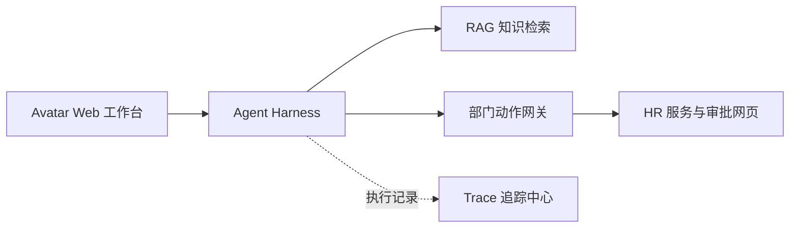

# Avatar2 可插拔企业 Agent 平台

Avatar2 是面向企业员工的内部业务助手，设计理念是“万物皆插件”。各部门将自己的业务能力作为独立服务接入，员工通过同一个 Web 工作台查知识、发起申请并跟踪结果。当前已接入 HR 请假与审批。

## 部门服务如何接入

部门插件声明可调用的工具、参数和确认要求。动作网关按部门和动作路由请求，部门服务负责业务授权、执行和数据存储。[部门插件接入说明](docs/department-plugins.md)

## 平台架构



Agent 按需检索法规或调用部门工具。工作台展示确认卡，员工确认后由 HR 正式提交。主管在独立 HR 网页批准，员工可回到原聊天卡或 Trace 查看同一单据。

## 已落地的 HR 业务

| 场景 | 业务流程 |
| --- | --- |
| 查规定与起草 | Bob 在聊天中询问年休假规定并指定日期，Agent 提供来源并起草请假。 |
| 提交与审批 | Bob 在卡片上确认并取得 HR 单号。指定主管从自己 Avatar 的账号菜单打开「我的待审批（HR）」，免二次登录进入 HR 批准。 |
| 回查 | Bob 在原卡点击「回查同一申请」，再到该轮 Trace 查看关联业务，两处核对同一单号及 `approved`。 |

## 代码结构

```text
avatar2/
├── web/                   # Web 工作台、对话与动作卡
├── services/
│   ├── ai/                # Agent 运行与 Trace 采集
│   ├── indexer/           # 文档索引
│   └── searcher/          # 知识检索
├── gateway.py             # 部门工具调用入口
├── plugins.py             # 部门插件与动作注册
├── avatar/
│   └── hr_service/        # 请假、审批与独立 HR 网页
├── source-documents/      # 年休假法规演示语料
├── scripts/trace/         # Trace 与 HR 流程验收脚本
├── docs/                  # 部门插件接入说明
└── docker/                # Docker Compose 启动配置
```

## 使用 Docker Compose 启动

以下示例在项目根目录使用 PowerShell 7.3 或更新版本执行。需要 Docker Engine 和 Docker Compose，Compose 必须支持配置中的 `!reset`。首次构建会下载基础镜像及依赖。

### 1. 配置并启动服务

```powershell
if (-not (Test-Path .env)) { Copy-Item .env.example .env }
```

在 `.env` 中填写自己的配置。建议使用独立测试环境和数据卷。

| 配置 | 本地开发说明 |
| --- | --- |
| `AVATAR2_WEB_PORT`、`APP_URL` | 默认工作台使用 `8300`，对应 `APP_URL=http://localhost:8300`。如使用 `8301`，两个值一起修改。浏览器使用与 `APP_URL` 一致的地址。 |
| `AVATAR2_HR_WEB_URL` | 本地为 `http://localhost:8892`，供浏览器打开独立 HR 网页。 |
| `DATABASE_PASSWORD`、`ENCRYPTION_KEY`、`ENCRYPTION_SALT` | 设置独立数据库密码和应用加密材料，保留自己的配置副本。 |
| `AVATAR2_INTERNAL_TOKEN`、`AVATAR2_BINDING_KEY` | 使用独立随机服务令牌与有效的 Fernet 密钥。 |
| `AGENT_TRACE_SEAL_KEY` | 设置随机密钥以启用 Trace 封存校验。 |

```powershell
$avatarCompose = @('-p','avatar2-source','--env-file','.env','-f','docker/docker-compose.yml','-f','docker/avatar2.compose.yaml','--profile','filesystem')
docker compose @avatarCompose up -d --build web connector-manager filesystem-connector gateway hr
docker compose @avatarCompose ps
```

打开 [本地工作台](http://localhost:8300)。首次访问时按引导创建工作台管理员，在管理设置里配置可用的对话模型与 Embedding 模型。新增文件系统知识源，容器路径填 `/knowledge`，同步完成后先搜索“年休假”。该路径通过 Compose 挂载 [仓库演示语料](source-documents/)。法规原文见 [《职工带薪年休假条例》](https://xzfg.moj.gov.cn/front/law/detail?LawID=208) 和 [《企业职工带薪年休假实施办法》](https://www.mohrss.gov.cn/xxgk2020/gzk/gz/202112/P020211229590352867273.pdf)。

### 2. 空数据卷初始化 HR 演示

在新环境中先为网关创建演示身份，再使用 HR 的一次性配对码建立服务配对。已有配对和绑定的环境可直接进入演示流程。

```powershell
docker compose @avatarCompose exec -e PY_AVATAR_DATA_DIR=/data gateway python -m avatar_service init-demo
docker compose @avatarCompose exec -e PY_AVATAR_DATA_DIR=/data gateway python -m avatar_service add-demo-user --handle bob --name Bob
docker compose @avatarCompose exec hr /opt/avatar-venv/bin/python -m hr_service setup-code
docker compose @avatarCompose exec gateway python -c 'import asyncio, os; from getpass import getpass; from avatar_service.db import Store; from avatar_service.hr_bridge import HrBridge; bridge = HrBridge(); bridge.start(Store(os.environ["AVATAR2_DATA_DIR"]), lambda *_: None); print(asyncio.run(bridge.pair(getpass("HR setup code: "))))'
```

初始化命令会输出本次创建的本地测试凭据，请仅在本机保存。网关以单 worker 运行，HR 服务使用网关进程签发的短时调用授权。随后在 Avatar 创建工作台测试账号，由工作台管理员进入 `/admin/settings/hr-directory`，将员工账号关联到 `bob`、主管账号关联到 `admin`。两人分别登录自己的 Avatar，从账号菜单的「员工服务」完成绑定。演示 HR 数据中，Bob 的指定审批人为 `admin`。

## 源码来源与许可

本仓库基于 Omni 本地源码快照 `c55816d7e36cce9d47c022382af4953e63af8625` 与 Avatar 本地源码快照 `b87c16a7532e8c80f88c268df9498f0c99992bf4`。这些快照包含取样时的本地改动。初始复制时，AI Python 文件与当时的本地源文件 SHA-256 一致。此后的 Avatar2 集成工作包括部门动作路由、工作台与 HR 身份衔接、通用动作卡以及 Trace 采集和展示。

仓库保留上游 [Apache License 2.0](LICENSE) 与源文件中的归属声明。外部评测数据、模型和其他依赖遵循各自的适用许可。
